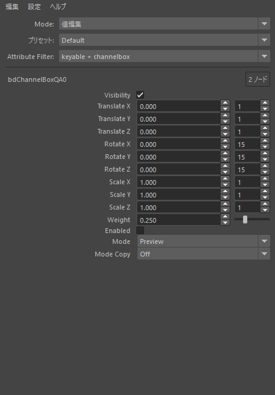
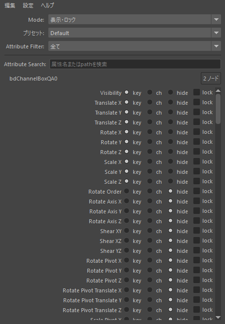
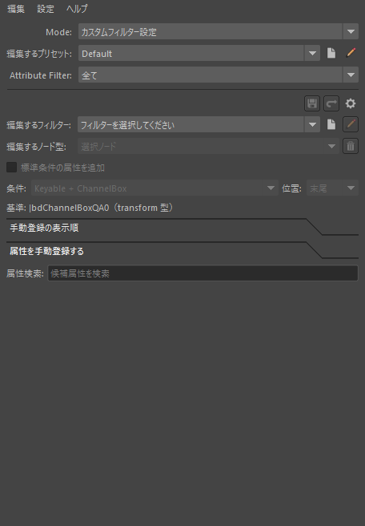

bdChannelBoxは、選択したMayaノードの属性値を編集し、Channel Boxへの表示やロックを
まとめて切り替えるツールです。bool、byte・short・longの整数、float・double、
距離、角度、enum、string属性に対応しています。

対応するbakedanuki-toolsとbakedanuki-utilを導入した、Maya 2025・2026・2027で使用します。

## まず使ってみる

1. Maya上部の **bakedanuki > tools > bdChannelBox** を選びます。
2. Mayaで編集したいノードを選びます。
3. **Mode: 値編集** の状態で、属性の値を入力します。
4. Enterで確定します。MayaのUndoで元の値へ戻せます。

初回はMayaの右側にドッキングします。パネルのタイトル部分をドラッグすると、
別の場所へのドッキング、タブ化、独立したウィンドウへの切り替えができます。
閉じた後も同じメニューから開けます。配置はMayaのワークスペースに保存されます。

スクリプトエディタのPythonタブから開くこともできます。

```python
from bd_tools import bd_channel_box

bd_channel_box.show()
```

## 画面の見方



| 項目 | 操作・表示内容 |
| --- | --- |
| ノード名 | 現在の基準ノード。名前を入力すると、そのノードを改名できます |
| Mode | 値編集、表示・ロック、カスタムフィルター設定を切り替えます |
| プリセット | 使用するカスタムフィルターの一覧を切り替えます |
| Attribute Filter | 一覧に表示する属性を絞り込みます |
| Attribute Search | 属性名を検索します。初期設定では「全て」フィルターのときに表示されます |
| 属性一覧 | 基準ノードの属性名と、選択したモードの操作欄を表示します |

### 複数ノードを選んだとき

**現在の選択リストで末尾にあるノードが基準です。** 画面の値、表示状態、ロック状態は
基準ノードだけを示します。ほかの選択ノードとの値の違いは表示しません。
複数ノードを対象にしている場合は、ノード名の右に件数を表示します。
名前欄のtooltipで選択順と基準ノードを確認できます。

値や状態を操作すると、全選択ノードにある同じ属性path・対応する種類の属性へ適用します。
属性が存在しないノードや編集できない対象は除外され、必要に応じて理由を通知します。
ノード名欄での改名は、基準ノードだけに適用されます。

ノード自体を選択してください。頂点などのコンポーネントや、属性だけの選択は対象に含みません。
選択数の上限はありません。

## 値を編集する

**Mode: 値編集** では、属性の種類に応じた入力欄が表示されます。

| 入力欄 | 操作 |
| --- | --- |
| 数値 | 数字を入力してEnterで確定します。上下ボタンでも増減できます |
| Slider | 範囲を持つ数値属性に表示されます。ドラッグして値を変更します |
| チェックボックス | bool属性のON／OFFを切り替えます |
| ComboBox | enum属性の項目を選びます |
| 文字列 | string属性の文字列を入力して確定します |

数値欄を初めてクリックすると入力文字全体を選択します。そのまま入力して置き換えられます。
フォーカス中の再クリックではカーソル位置を移動でき、横ドラッグで文字の一部を選択できます。
距離や角度の数値は、Mayaで現在使用している表示単位で入力します。

### 複数の属性へ入力する

属性名をクリックして行を選択します。Ctrlクリックで追加・解除、Shiftクリックで
範囲選択できます。属性名からの縦ドラッグでも範囲を選べます。

選択した行の入力欄を操作すると、対応する選択属性へまとめて適用します。
選択外の行の入力欄を操作した場合は、その行だけに適用します。

- **数値の直接入力** は、選択した編集可能な数値属性を同じ表示数値へ揃えます。
- **値欄の上下操作** は、各対象の現在値へ同じ増減量を加え、元の値の差を保ちます。
- **Slider** は、操作位置の表示数値へ揃えます。
- **bool・enum・string** は、対応する同種の選択属性へ同じ値を適用します。
  enumでは項目の整数値と名前の定義が一致する属性が対象です。

複数数値への入力はEnterや通常のフォーカス移動で確定し、Escapeで取り消します。
一括入力後は、全属性・全ノードをまとめて1回のUndoで戻せます。
Sliderも1回のドラッグを1回のUndoで戻せます。
数値が編集対象のどれかの入力範囲を超える場合は、その入力全体を変更せず通知します。

### Stepを変更する

Sliderのない数値行では、値欄の右に増減量のStep欄を表示します。
Stepだけを変更しても、属性値は変わりません。次の値欄の上下操作から使用します。

float系では、通常数値・距離の初期値は1、角度は15、radiusは0.1です。
整数の初期値は1で、正の整数を指定できます。
Step欄のある複数行を選んで操作すると、それぞれへ同じ表示数値のStepを設定できます。
整数とfloatが混在する場合は、整数としても有効な値を指定してください。

Stepは個人設定として保存され、パネルを閉じたりMayaを再起動したりしても復元されます。
別ノードの同じ属性path・型区分にも使われます。
右クリックの **Step設定 > 初期値に戻す: 選択属性／全ての属性** で戻せます。
「全ての属性」は、現在表示していない属性の保存済みStepも初期化します。

**設定 > 未フォーカス時のホイール編集** をONにすると、数値・Step・enum欄へ
マウスを重ねてホイール編集できます。初期状態はOFFで、未フォーカス時のホイールは
一覧のスクロールに使います。

### 値をコピー・ペーストする

メニューバーの **編集 > コピー**、**編集 > ペースト** を使います。
値編集モードの属性行を右クリックしても同じ操作を選べます。

- **コピー > 選択属性** は、基準ノードで選択中の属性値をコピーします。
  **全属性** は、表示フィルターや行選択に関係なく基準ノードの対応属性をコピーします。
- **ペースト > 選択属性** は、コピーした属性pathと一致する選択属性へ貼り付けます。
  1属性だけをコピーした場合は、その値を互換性のある選択属性すべてへ貼り付けられます。
- **ペースト > コピー元と同じ属性：全て** は、全選択ノードの同じ属性pathへ貼り付けます。
  Keyableなどの条件を指定して貼り付け先を絞ることもできます。

コピー値はOSクリップボードを使うため、別のMayaにも渡せます。
型・単位区分が一致しない属性や、ロックなどで編集できない属性は貼り付け対象から除外します。

## 属性を絞り込む・検索する

**Attribute Filter** には、次の標準フィルターがあります。

| フィルター | 表示する属性 |
| --- | --- |
| 全て | 非表示の属性も含む、対応する属性 |
| keyable + channelbox | キー設定可能、またはChannel Boxに表示される属性 |
| keyable | キー設定可能な属性 |
| channelbox | キー設定不可で、Channel Boxに表示される属性 |
| hide | キー設定不可で、Channel Boxから非表示の属性 |

フィルターの条件は基準ノードで判定します。フィルターや検索の変更だけでは、
Mayaの属性値・表示状態・ロックは変わりません。

**Attribute Search** は表示名・属性名・正式pathを、大文字と小文字を区別せず検索します。
空白で複数の語を指定すると、すべての語を含む属性を表示します。
正規表現やワイルドカードは使いません。

カスタムフィルター内でも検索する場合は、**設定 > 検索欄の表示 > 常に表示** を選びます。
検索で隠れた行は属性選択から外れます。検索文字列はパネルを閉じるとリセットされます。

## 表示とロックを変更する

**Mode: 表示・ロック** に切り替えると、各行に次のボタンを表示します。



| ボタン | 操作後の状態 |
| --- | --- |
| key | キー設定可能にします |
| ch | キー設定不可にし、Channel Boxへ表示します |
| hide | キー設定不可にし、Channel Boxから非表示にします |
| lock | ロック／解除を切り替えます |

`key`・`ch`・`hide`はどれか1つを選びます。ロックは独立して変更できます。
`hide`にしても属性自体は削除されません。再表示する場合はAttribute Filterを「全て」や
「hide」にして、`key`または`ch`を選びます。

複数の属性行を選んでボタンを押すと、選択した対応属性へ同じ状態を適用します。
ボタンから左ドラッグして同じ列を縦になぞると、通過した行だけを開始時の操作へ揃えられます。
`lock`から始めた場合は、開始時にロックされていれば解除、解除されていればロックします。
なぞり操作は画面内の行が対象で、画面端での自動スクロールは行いません。

1回のクリックやなぞり操作を、1回のUndoで戻せます。
なぞり操作をEscapeで終了しても、それまでの変更は残ります。元に戻す場合はUndoを使います。

## カスタムフィルターを作る

よく使う属性を、ノード型ごとのフィルターとして保存できます。
構成は **プリセットグループ → プリセット → カスタムフィルター** の3段階です。
プリセットは、使用するフィルターの一覧・順序・表示ON／OFFをまとめます。



1. **設定 > カスタムフィルター管理...** を開きます。
2. 必要に応じてグループ、プリセット、フィルターを新規作成します。
   既存のJSONを使う場合は、該当する段の「追加」から登録します。
3. **Mode: カスタムフィルター設定** に切り替え、編集するプリセットとフィルターを選びます。
4. 見本にするノードをMayaで選びます。「編集するノード型」が「選択ノード」の場合は、
   基準ノードの型を編集します。既に定義した型は型名を直接選択して編集できます。
5. 「属性を手動登録する」で必要な属性を「含める」にします。
6. 「手動登録の表示順」で順序を調整し、保存ボタンで確定します。
7. 「値編集」へ戻り、Attribute Filterの`Custom: フィルター名`を選びます。

ここで保存するのは、選択したノードと同じ**型全体で使うフィルター定義**です。
フィルター設定の「含める／含めない」では、Mayaの属性値・表示・ロックは変更しません。

### 順序と標準属性の追加

「手動登録の表示順」はCtrl／Shiftで複数選択できます。
上下ボタンでは一段ずつ移動し、中ボタンドラッグでは選択行を行間へまとめて挿入します。
一覧の上下端ではドラッグ中に自動スクロールします。
「除外」はフィルターの手動登録から外す操作です。Mayaの属性は削除しません。

**標準条件の属性を追加** をONにすると、Keyableなどの条件に合う属性を、
手動登録の先頭または末尾へ自動追加できます。手動登録した属性との重複は除きます。
「含めない」にした属性も標準条件を満たせば自動追加されます。

型の定義がない場合は、標準のKeyable + ChannelBox条件で表示します。
その型の定義があり、手動登録が空・標準追加がOFFの場合は、何も表示しません。

### 保存・破棄・共有

未保存の変更は編集欄の`*`で確認できます。保存ボタンで確定し、破棄ボタンでは
保存済みの内容へ戻します。**パネルを閉じる前に、残したい変更を保存してください。**

管理画面では、フィルター名の左にある目のアイコンで、Attribute Filterへの表示を切り替えます。
管理画面での「除外」は登録・参照だけを外してJSONを残します。
「ファイルを削除」は実ファイルを削除するため、確認画面の対象と参照元を確認してください。

共有する場合は、管理画面の各段の右端にあるエクスポートボタンを使います。
グループまたはプリセットは正常な1件、フィルターは正常な1件以上を選びます。
グループ・プリセットを出力すると、参照する下位のJSONも一式で出力します。
出力フォルダー全体を受け渡してください。受け取った側は、その中のグループなどを
管理画面の「追加」から登録できます。

同じJSONを複数のプリセットから参照すると、属性定義の編集も共有されます。
独立したフィルターが必要な場合は、フィルター自体を「複製」してください。

## オンラインヘルプを開く

bdChannelBox上部の **ヘルプ > オンラインヘルプ** を選ぶと、既定のブラウザーで本ページを開きます。
閲覧にはインターネット接続が必要です。

## 困ったとき

| 状況 | 確認すること |
| --- | --- |
| 属性が見つからない | 対象のノードを選択し、Attribute Filterを「全て」にして検索を解除します。カスタムフィルターでは型の定義と標準追加の設定も確認します |
| 検索欄がない | 「設定 > 検索欄の表示」を確認します。初期設定では「全て」以外で非表示になります |
| 値を変更できない | 自身や親属性のロック、入力接続、操作時の通知を確認します。constraintやexpressionなど未対応の接続は値を編集できません |
| 一部のノードに反映されない | 同じ正式属性pathと対応する型が存在するか、ロックや接続による制限がないか確認します |
| アニメーションの値が戻る | 通常時間キー・Animation LayerではAuto Keyを確認します。Auto Key OFFやDriven Keyへの入力は一時値で、再評価により接続元の値へ戻ることがあります |
| フィルターが一覧に出ない | 現在のプリセット、管理画面の目のアイコン、JSONの読込状態を確認します。外部で修正した場合は「全て再読込」を実行します |
| オンラインヘルプが開かない | 画面の通知、既定ブラウザーと通信環境を確認します。ブラウザーが開いてもページが表示されない場合は、サイトの公開状況も確認してください |

見えている値は基準ノードの値です。複数選択中は、操作前にノード件数と基準を確認してください。
配列、compound全体、time、int64などは対象外です。対応するcompoundの子属性は個別に表示します。

パネルの配置を初期状態へ戻す場合は、スクリプトエディタのPythonタブで実行します。
Stepなどの個人設定は維持されます。未保存のフィルター編集は、先に保存してください。

```python
from bd_tools import bd_channel_box

bd_channel_box.reset_layout()
```
